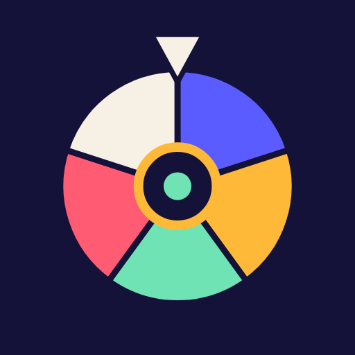
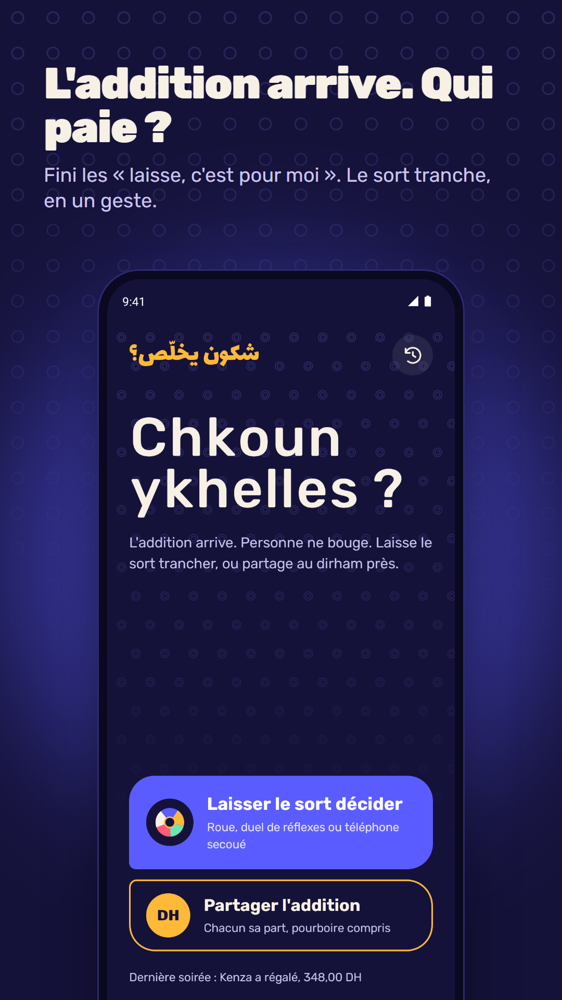
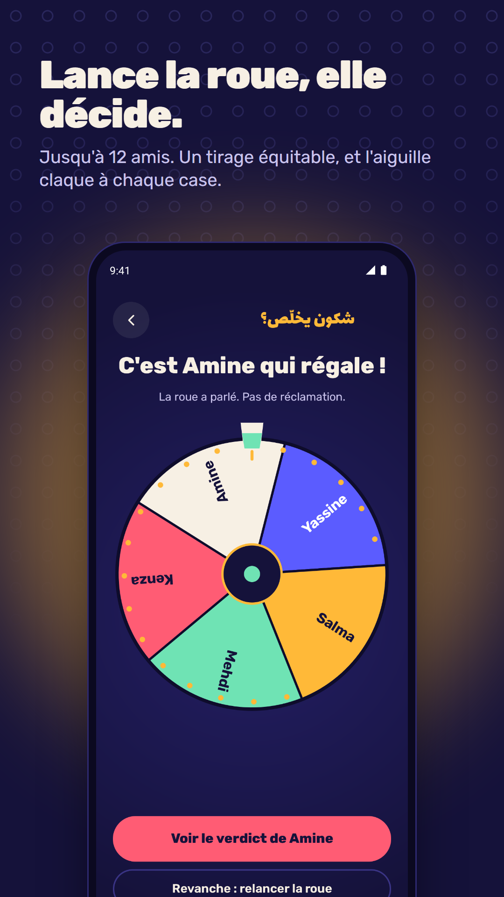
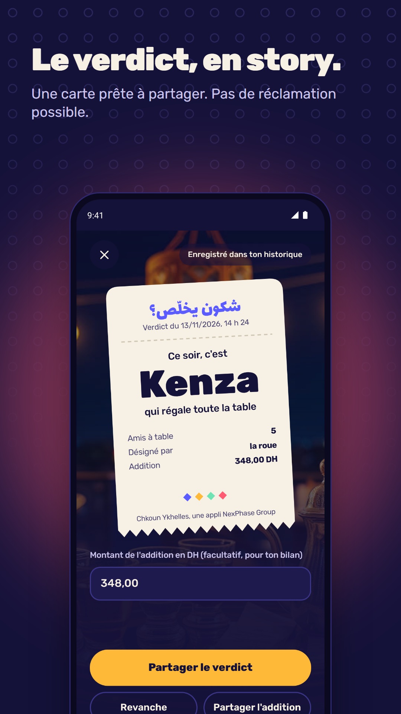

# Chkoun Ykhelles ?



**شكون يخلّص؟** L'addition arrive, personne ne bouge ? Cette appli Android tranche : une roue, un duel de réflexes ou un téléphone qu'on secoue désigne qui régale. Ou bien on partage l'addition au dirham près.

Une appli [NexPhase Group](https://nexphasegroup.ma/), faite à Casablanca.

| | | |
|---|---|---|
|  |  |  |

## Fonctionnalités
- **La roue** : lancée d'un geste, tirage équitable (le gagnant est tiré au hasard, puis l'animation s'arrête sur lui).
- **Le duel** : deux finalistes, un verre de thé qui passe au vert, le plus lent paie.
- **Secouer** : l'accéléromètre désigne celui qui régale.
- **Le verdict** : un ticket à partager en story (image 1080 × 1920).
- **Partager l'addition** : montant, personnes, pourboire.
- **Mon bilan** : combien j'ai payé, combien j'ai épargné, historique des soirées.

## Vie privée
Aucune autorisation, aucun compte, aucune publicité, aucune donnée envoyée : tout reste sur le téléphone. Voir la [politique de confidentialité](store/confidentialite.html).

## Technique
- Kotlin, vues Android natives dessinées en code, **aucune bibliothèque externe** (APK d'environ 510 Ko).
- minSdk 26, targetSdk 36.
- Polices [Rubik](https://github.com/googlefonts/rubik) et [Lalezar](https://github.com/BornaIz/Lalezar), sous licence SIL OFL 1.1 (`docs/OFL-*.txt`).

## Compiler
```
gradlew assembleDebug      # version de test
gradlew bundleRelease      # version Play Store (clé de signature lue hors du dépôt)
```
La signature lit `~/.android-keys/chkoun/signature.properties`, qui n'est jamais dans le dépôt. Sans ce fichier, la version finale est produite non signée.

© 2026 NG CORP (NexPhase Group). Tous droits réservés.
